<div align="center">
  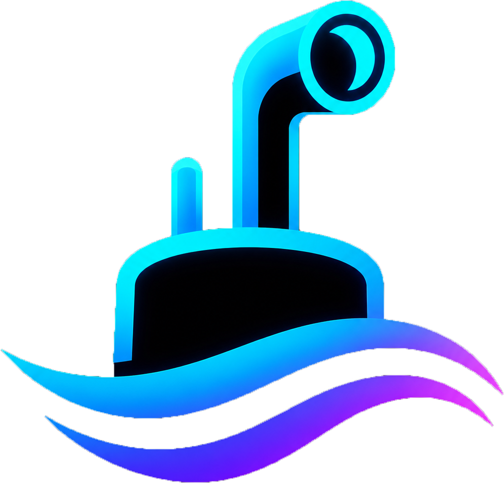
  <h1>Submarine — SSH, SFTP, RDP, VNC &amp; Telnet Client</h1>
  <p><strong>A fast, free, open-source remote-access client for Windows, macOS, Linux and Android.</strong></p>
  <p>Terminal, dual-pane SFTP, port forwarding, folder mirror, remote desktops and encrypted profile sync in one native window. Built with Rust and Tauri.</p>
  <p>
    <a href="https://github.com/sinaxhpm/submarine/releases"></a>
    <a href="https://github.com/sinaxhpm/submarine/releases"></a>
    <a href="https://github.com/sinaxhpm/submarine/actions"></a>
    
    
  </p>
</div>

---

<div align="center">
  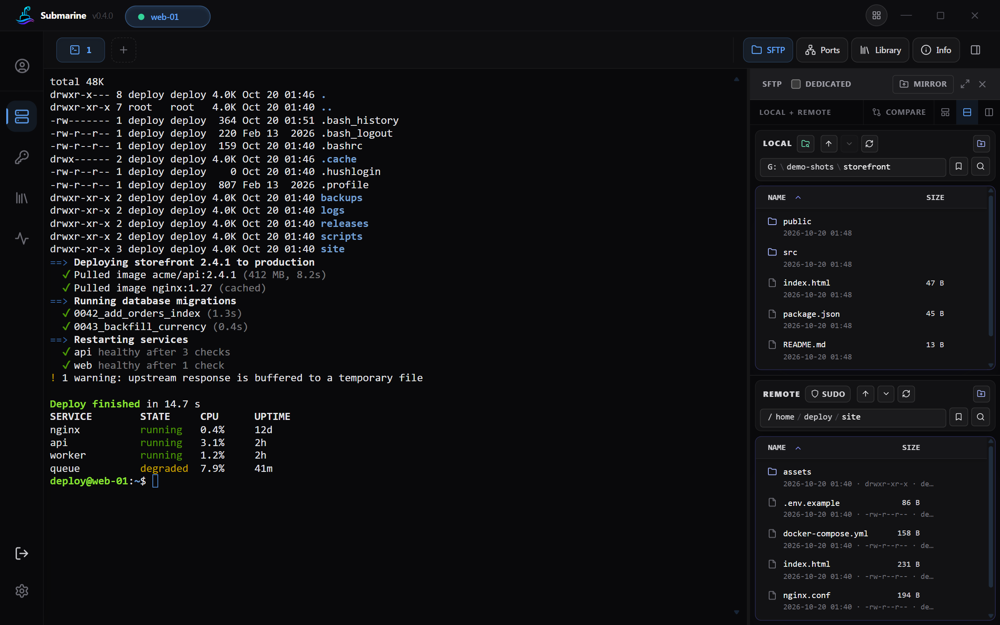
</div>

> **TL;DR** — Submarine is a free, open-source SSH and SFTP client for Windows, macOS, Linux and Android. It replaces the usual PuTTY + WinSCP + tunnel-manager (+ Remmina / VNC viewer) stack with one tabbed window per server: terminal, SFTP, port forwarding (SOCKS / HTTP / local / remote), folder mirror, server info, Docker, and RDP, VNC and Telnet sessions. Profiles are encrypted on your device, and optional cloud sync can keep them in step across your machines and your phone. Built with Rust and Tauri. MIT licensed.

## At a glance

- **SSH, SFTP, Telnet, VNC and RDP in one app** — pick the type when you add a server; each opens as a tab (the terminal for SSH and Telnet, the remote screen for VNC and RDP)
- **One window, many tools per server** — terminal, SFTP, tunnels, folder mirror, Docker, live server info and a command library, all around the same session
- **Watch many servers at once** — split view for two sessions, a **Wall** pinboard for any terminals across hosts, and **broadcast input** to several sessions at once
- **Works with your existing SSH setup** — reads `~/.ssh/config` (Include, Match, ProxyJump, ProxyCommand, IdentityFile, certificates), logs in with keys from **ssh-agent / Pageant / the Windows OpenSSH agent**, trusts your `known_hosts`
- **Native and cross-platform** — Windows, macOS, Linux (`.deb` / `.rpm` / Arch / AppImage) and Android, with the same encrypted vault on all of them
- **Encrypted profiles** — Argon2id + AES-256-GCM on your device; open a profile with **Windows Hello** or an **Android fingerprint** if you turn that on
- **Optional cloud sync** — records are encrypted before upload; use the hosted server, or [point Submarine at your own](#cloud-sync-optional)
- **Import from anywhere** — PuTTY `.reg`, MobaXterm `.mxtsessions`, OpenSSH config and Submarine JSON exports
- **Honest about risk** — Telnet and plain VNC are labelled *not encrypted*, and the built-in RDP client is marked *experimental*

## Screenshots

<table>
  <tr>
    <td colspan="2" align="center">
      <a href="docs/screenshots/compare.png">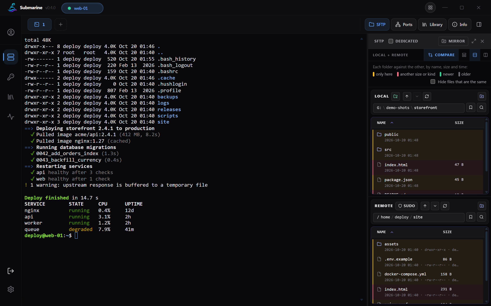</a>
      <br/><sub><b>Compare folders</b> — see at a glance what is only on one side, differs in size, or is newer or older, with a switch to hide files that are the same</sub>
    </td>
  </tr>
  <tr>
    <td width="50%" valign="top" align="center">
      <a href="docs/screenshots/vnc.png">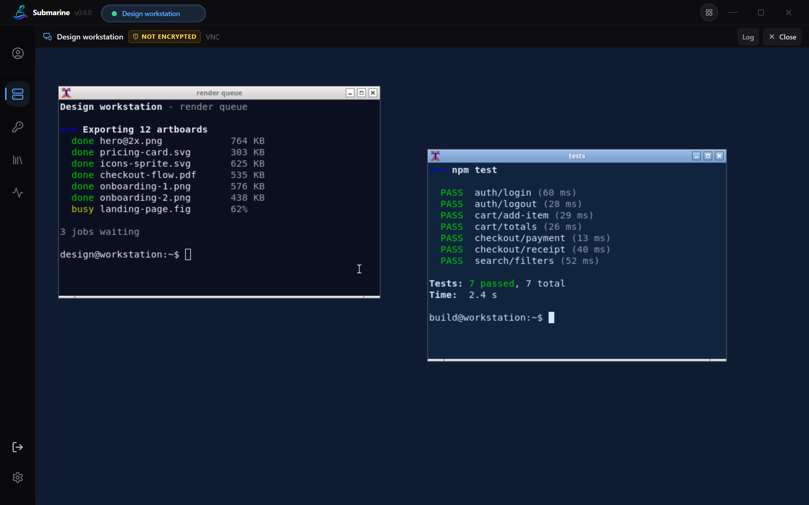</a>
      <br/><sub><b>VNC</b> — the remote screen in the tab, directly or through an SSH server; unencrypted VNC says so</sub>
    </td>
    <td width="50%" valign="top" align="center">
      <a href="docs/screenshots/rdp.png">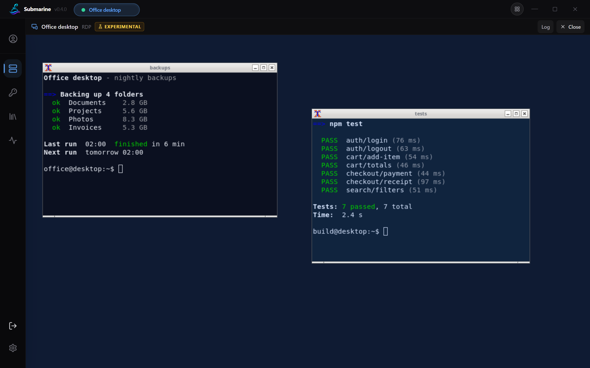</a>
      <br/><sub><b>RDP</b> — opens in your computer's RDP app by default; the built-in client (shown) is experimental and opt-in</sub>
    </td>
  </tr>
  <tr>
    <td colspan="2" align="center">
      <a href="docs/screenshots/wall.png">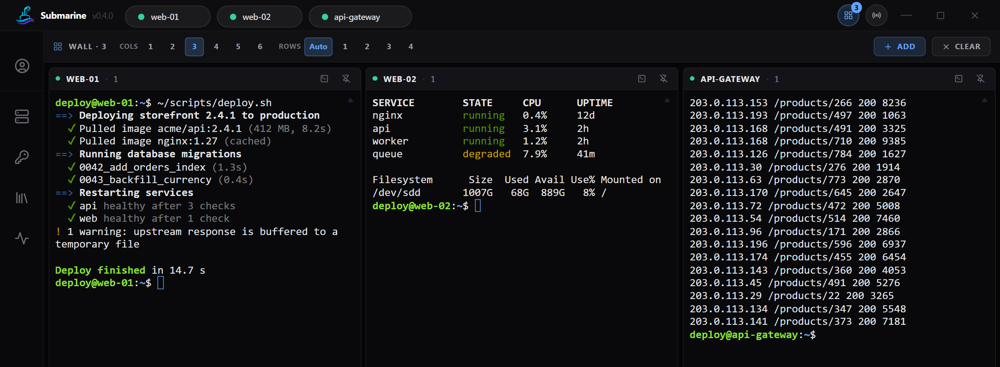</a>
      <br/><sub><b>The Wall</b> — pin terminals from any servers into one grid and watch them together</sub>
    </td>
  </tr>
  <tr>
    <td colspan="2" align="center">
      <a href="docs/screenshots/monitor.png">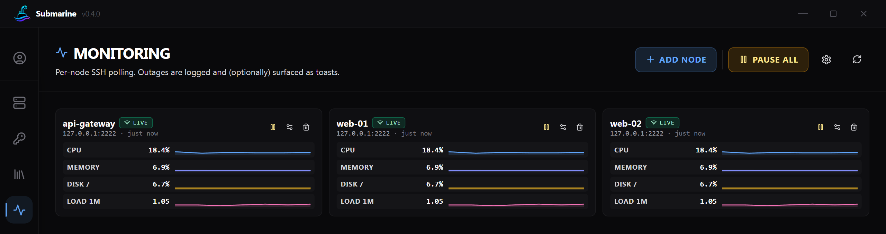</a>
      <br/><sub><b>Monitoring</b> — per-node SSH polling for CPU, memory, swap, disk, load and network, with graphs, outage log and your own custom metrics</sub>
    </td>
  </tr>
  <tr>
    <td colspan="2" align="center">
      <a href="docs/screenshots/servers-home-lab.png">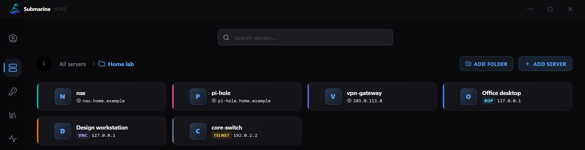</a>
      <br/><sub><b>Servers</b> — nested, colour-tagged folders with drag and drop; RDP, VNC and Telnet servers carry a badge</sub>
    </td>
  </tr>
</table>

<table>
  <tr>
    <td width="33%" valign="top" align="center">
      <a href="docs/screenshots/ports.png">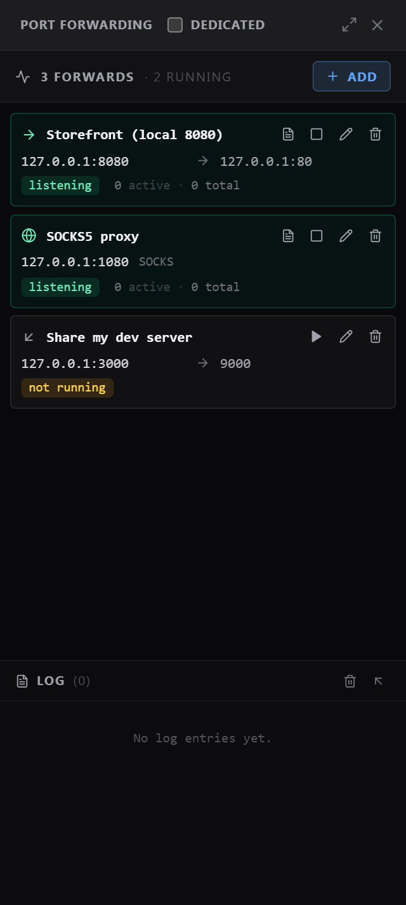</a>
      <br/><sub><b>Port forwarding</b> — local, remote and dynamic SOCKS / HTTP tunnels, named, started and stopped one by one</sub>
    </td>
    <td width="33%" valign="top" align="center">
      <a href="docs/screenshots/library-panel.png">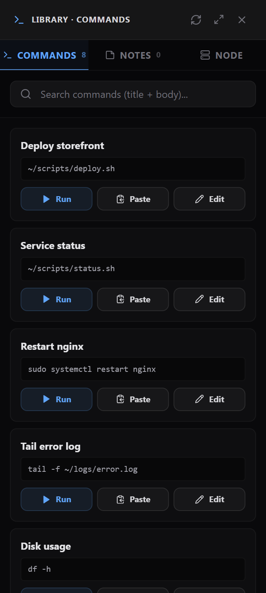</a>
      <br/><sub><b>Command library</b> — Run or Paste saved commands in the open session; notes and node details beside them</sub>
    </td>
    <td width="33%" valign="top" align="center">
      <a href="docs/screenshots/add-server.png">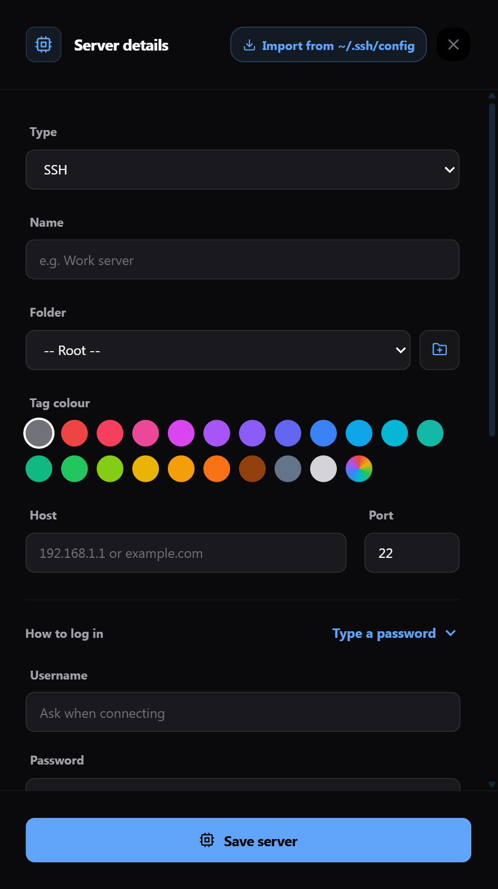</a>
      <br/><sub><b>Server form</b> — type (SSH / RDP / VNC / Telnet), folder, tag colour, login, proxy and tunnels in one place</sub>
    </td>
  </tr>
</table>

<table>
  <tr>
    <td width="50%" valign="top" align="center">
      <a href="docs/screenshots/profiles.png">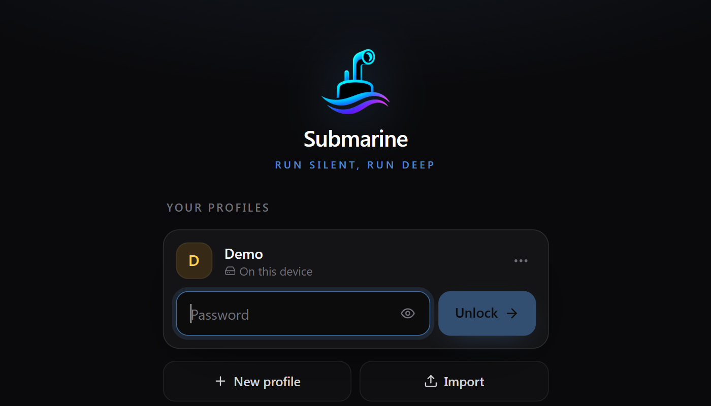</a>
      <br/><sub><b>Profiles</b> — each profile is its own encrypted vault, local or synced</sub>
    </td>
    <td width="50%" valign="top" align="center">
      <a href="docs/screenshots/terminal-colours.png">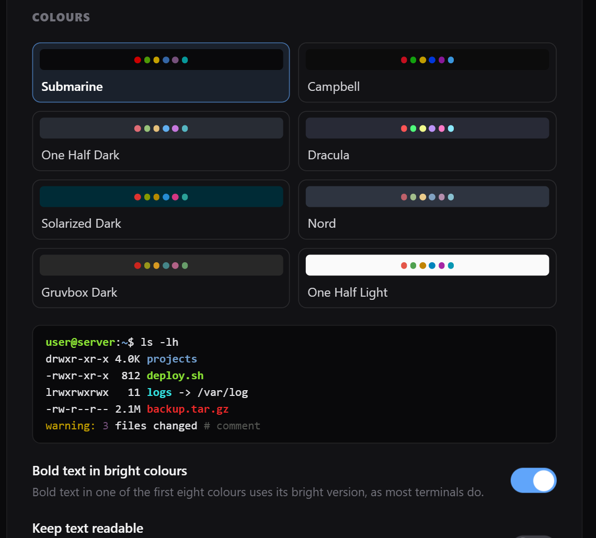</a>
      <br/><sub><b>Terminal colours</b> — built-in schemes, or bring your own from Windows Terminal</sub>
    </td>
  </tr>
  <tr>
    <td width="50%" valign="top" align="center">
      <a href="docs/screenshots/library.png">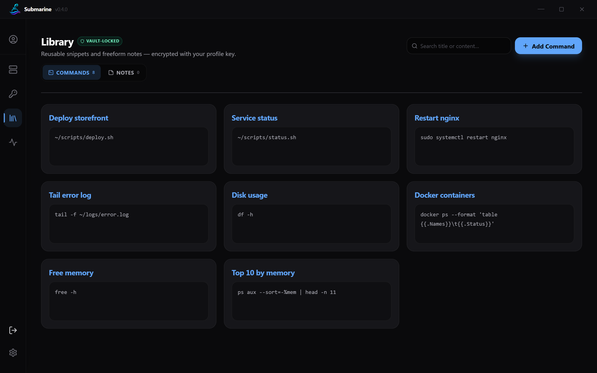</a>
      <br/><sub><b>Library</b> — commands and notes for all servers, or only for some of them</sub>
    </td>
    <td width="50%" valign="top" align="center">
      <a href="docs/screenshots/logins.png">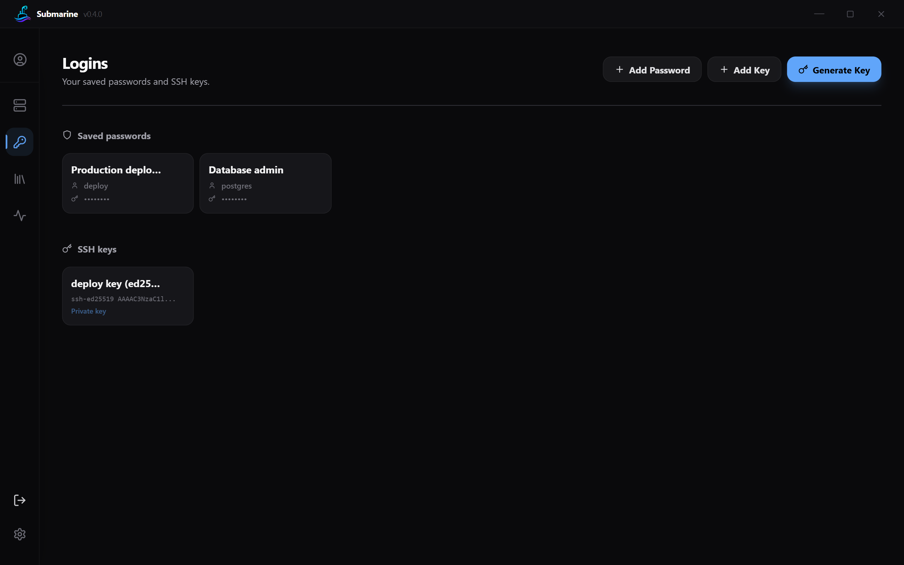</a>
      <br/><sub><b>Logins</b> — saved passwords and SSH keys, with built-in key generation</sub>
    </td>
  </tr>
</table>

<details>
<summary>More pictures: mirror, servers, settings, terminal</summary>

<p align="center">
  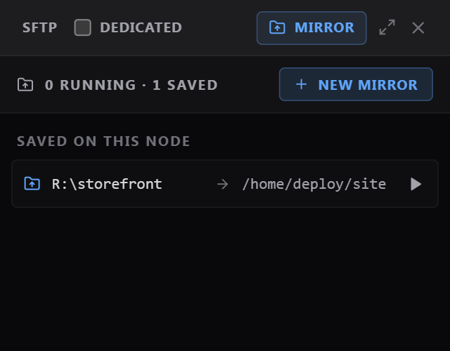
  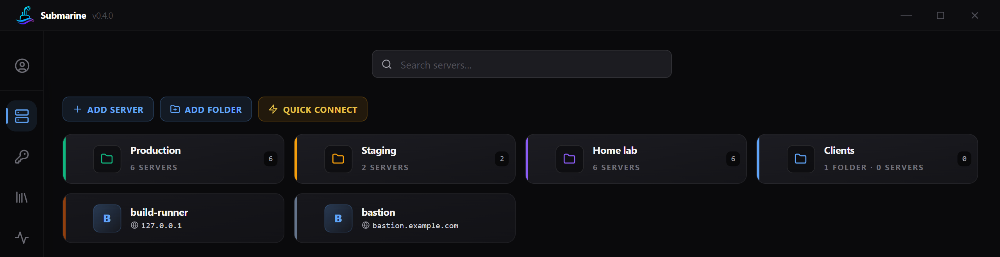
</p>
<p align="center">
  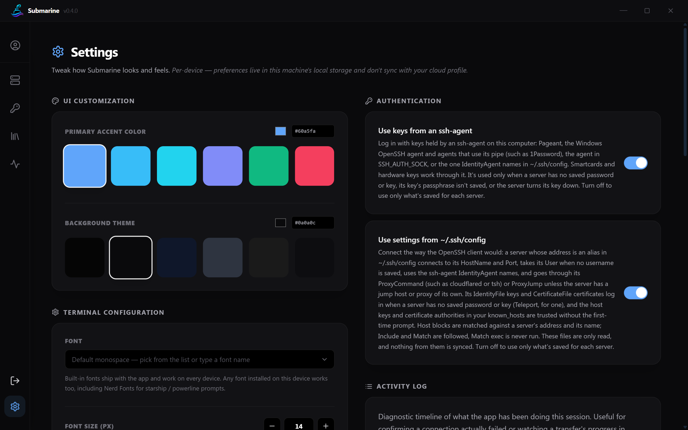
  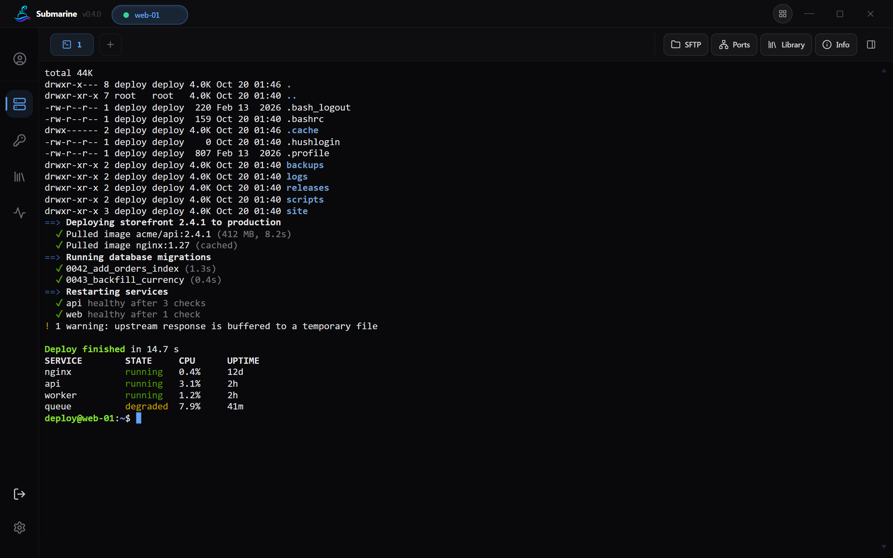
</p>

</details>

## Looking for an alternative to…

If you're searching for one of these, Submarine is a direct fit:

- a free **PuTTY alternative for macOS and Linux** (and a tabbed PuTTY replacement on Windows)
- a **WinSCP alternative** that lives in the same window as your terminal
- a **MobaXterm alternative** that isn't Windows-only
- a free **Termius alternative** without a subscription — your encrypted profiles can travel from desktop to your **Android phone**
- a **Tabby / iTerm2 + SFTP** combination that is one app
- a simple **Remmina or Remote Desktop Connection** launcher and **VNC viewer** that sits next to your SSH servers
- an **rsync GUI** that mirrors a local folder to a remote SSH host with conflict resolution
- an **Android SSH client** (ConnectBot / JuiceSSH style) that shares saved servers with your desktop

## Why Submarine

Most SSH clients feel like they were built a decade ago and never updated. Submarine is a modern alternative for developers and sysadmins who connect to remote machines every day.

- **Native webview, no bundled Chromium.** Built with Rust + Tauri. Desktop installers are 7–13 MB (the AppImage and the Android APK are larger).
- **One window, everything you need.** Terminal, SFTP file browser, port tunnels, folder sync, saved commands and remote desktops are tabs around each server. No more juggling PuTTY, WinSCP, a tunnel app and an RDP client.
- **Fits the setup you already have.** Your `~/.ssh/config`, your agent, your `known_hosts`, your Teleport or OpenSSH certificates and ProxyJump / ProxyCommand hosts all work.
- **Secure by default.** Saved servers are encrypted on disk. Cloud sync is optional and encrypts record contents before upload. Unencrypted protocols are labelled as such. See [Security and privacy](#security-and-privacy) for exactly what is and isn't protected.
- **Truly cross-platform.** Windows, macOS (Apple Silicon; Intel via Rosetta) and every major Linux distribution — `.deb`, `.rpm`, Arch package and AppImage — plus Android.

## Key Features

### Servers and organisation

- **Nested folders** with colours, drag and drop to move servers and folders, and a search box
- **Tag colours** on every server, so production and staging are never confused
- **Four server types**: SSH, Telnet, VNC and RDP — one list, one vault
- **Jump hosts and proxies** per server: another saved server as a jump host, or a SOCKS5 or HTTP proxy
- **Import** from PuTTY `.reg`, MobaXterm `.mxtsessions`, an OpenSSH config, or a Submarine JSON export; **generate a key** right from the server form
- **Quick connect** for a host you haven't saved yet — it is added to your root folder (with what you typed, password or key included), so remove it afterwards if you don't want it kept
- **Autostart**: flag a server and it opens and connects when the app launches
- **Per-server notes** and **per-server commands** (or commands for all servers)

### Login methods

- Passwords, key files and pasted keys (OpenSSH, PEM, PKCS#8 and SEC1 formats; RSA, ECDSA including P-521, Ed25519), with or without a passphrase
- Keyboard-interactive and two-factor prompts, with the saved password filled in where the server asks for it
- **ssh-agent**: keys from Pageant, the Windows OpenSSH agent (and agents that use its pipe, such as 1Password), `SSH_AUTH_SOCK` or the `IdentityAgent` named in your config; smartcards and hardware keys work through it. A per-device switch turns it off.
- **OpenSSH and Teleport certificates** from `~/.ssh/config`, with the CA keys in your `known_hosts` trusted
- A **blank username** is asked for when you connect; a missing password or passphrase is asked for too
- **Host keys**: trust on first use with a fingerprint prompt, pinned afterwards; a changed key (or a key of a different kind than the one on file) is flagged before anything secret is sent
- Legacy-friendly: NIST-curve and SHA-1 group-exchange key exchanges are offered, so older appliances still connect

### Terminal

- Tabbed sessions per server and several shells per session; **rename** tabs
- Full xterm.js — true colour, ANSI 256, mouse support, **10,000 lines of scrollback** by default (you can change it)
- **Colour schemes**: Submarine, Campbell, One Half Dark / Light, Dracula, Solarized Dark, Nord and Gruvbox Dark, or import your own from Windows Terminal; built-in fonts, or any font installed on the device (Nerd Fonts work for starship / powerline prompts)
- **Select to copy**, right-click to paste (bracketed paste), Ctrl+Shift+C / Ctrl+Shift+A; wrapped lines copy as one line
- **Links ask first** — a clickable link, and a multi-line paste, wait for your OK
- **Type the saved password at a sudo prompt** with one button
- **Reconnect-safe scroll-back** — when a session drops and reconnects, earlier output stays; a divider marks the boundary. If a connect times out or the server can't be reached, Submarine offers to try again.
- **Container shells** — one click from the Docker tab opens a `docker exec` shell with a `bash → sh → ash` fallback
- **Shell config push** — send selected dotfiles from this computer to a server on demand, with a preview; existing files are moved to a trash folder first, and keys, tokens and history are never pushed

### SFTP file browser

- Dual pane (local and remote) as **tabs, stacked, or side by side**, and the tool panel can sit on any side of the terminal or go full screen
- **Compare** the local and the remote folder by name, size and time
- Drag and drop between panes, from your file manager, and onto folders; **multi-select** with Ctrl/Shift-click, Select-All and Ctrl+A
- **Archive** a selection and **extract** zip or tar files, in both panes
- **Live edit** — double-click a remote file to open it in your editor; saves upload back automatically
- **Overwrite confirmation** for uploads and downloads, with "apply to all" for batches
- Per-pane filter with `*` and `?` wildcards, folder **bookmarks per server**, an **Owner** column, a path bar with clickable parts, chmod / chown (permissions grid)
- **Root mode through sudo** for file operations
- **Works on servers without SFTP** (OpenWrt's Dropbear, an sshd without the SFTP subsystem): file access runs over ordinary shell commands, and the pane says "Shell"

### Folder mirror

Pick a local folder, pick a remote folder, and Submarine keeps them in sync.

- **Two-way initial sync** that compares size and content hash, not just timestamps
- **Live watcher** — every save, create, rename or delete on the local folder reaches the server
- **Conflict resolution per mirror**: **Local wins** (default), **Remote wins** or **Newer wins**; **excludes** such as `node_modules` and `*.log`
- **Soft delete** — removed files move to `.submarine-trash/` on the server
- A mirrored folder that goes away deletes nothing on the server, and a dry-run preview calls out what would be overwritten before each start

### Port forwarding

- Local (`-L`), remote (`-R`) and dynamic (`-D`) tunnels, **named**, started and stopped one by one, saved with the server
- Dynamic tunnels speak **SOCKS4, SOCKS4a, SOCKS5, SOCKS5h, HTTP CONNECT and plain HTTP proxy**
- Autostart with the app; a log shows what each tunnel did

### Remote desktops: VNC, RDP and Telnet

- **VNC** opens as the remote screen in the tab, directly or through an SSH server, on the PC and on the phone (touch, zoom, a keyboard button). Tight, ZRLE, TRLE, CopyRect and Raw encodings; the desktop takes the tab's size where the server allows it. Plain VNC is **not encrypted**, and the form, the list and the tab say so.
- **RDP** opens in **this computer's RDP app** by default (Windows Remote Desktop Connection, Remmina or FreeRDP on Linux, the system handler on macOS), with per-server full-screen, window size, clipboard and drive-sharing options kept on this device. The **built-in RDP client** (in the tab, on the PC and the phone) is **experimental** and opt-in; its certificate is pinned like an SSH host key and checked before anything secret is sent.
- **Telnet** opens in a terminal tab, directly or through an SSH server, with proper option negotiation. It is **not encrypted** and says so.
- All three can go **through an SSH server** you already have.

### Server info and Docker

A read-only inspection pane for the active session — no terminal commands needed.

- **Overview** (hostname, OS, kernel, uptime, load, CPU, memory, swap, disks), **Network** (interfaces, routes, `iptables` / `nftables` rules), **Ports** (listening sockets with process names) and **Services** (`systemctl` units with Start / Stop / Restart)
- **Docker manager**: containers (start, stop, restart, pause, kill), live logs, stats, inspect, env / mounts / ports, images, volumes, networks, compose files, safe prune (never `--volumes`, never `-a`), and `docker exec` shells as session tabs

### Monitoring and the Wall

- **Monitoring**: per-node SSH polling for CPU, memory, swap, disk, load and network, graphs, an outage log with optional notifications, and your own **custom metrics** (a command whose output becomes a graph, a number or text)
- **The Wall**: pin any terminals from any servers into a grid; choose the columns and the rows on screen
- **Split view** to tile two sessions, and **broadcast input** to the sessions you select

### Profiles and security conveniences

- Each profile is its own vault with its own master password; several can live on one device
- **Quick unlock** (off by default): open a profile with **Windows Hello** (needs a TPM) or an **Android fingerprint**. The password itself is never kept: the vault key is sealed to a key in the TPM or the Android Keystore. Not offered on Linux or macOS, never synced or exported.
- **Portable mode** on Windows: all data in a `submarine-data` folder next to the exe

### Cloud sync (optional)

- Turn it on to keep your profiles in step across your computers and your phone; sync sends **only what changed**, compressed
- **Share a profile** with other accounts as **Owner, Editor or Viewer**; changes by others that would run something, and mass deletions, wait for your OK
- Use the hosted server, or **point Submarine at your own sync server** (Cloud Sync → Sync server), with an optional proxy for the sync connection
- What the server can and can't see is spelled out under [Security and privacy](#security-and-privacy)

## Install

Pick a binary from the [latest release](https://github.com/sinaxhpm/submarine/releases) and you're done — no extra dependencies.

| OS | File |
|---|---|
| Windows 10 / 11 | `.exe` installer or `.msi`, or the [portable](#portable-mode-windows) `.zip` |
| macOS (Apple Silicon, or Intel via Rosetta) | `.dmg` or `.app.zip` |
| Debian / Ubuntu / Mint | `.deb` — `sudo apt install ./submarine_*.deb` |
| Fedora / RHEL / openSUSE | `.rpm` — `sudo dnf install ./submarine-*.rpm` |
| Arch / Manjaro / EndeavourOS | `.pkg.tar.zst` — `sudo pacman -U submarine-*.pkg.tar.zst` |
| Any Linux | `.AppImage` — `chmod +x` and double-click |
| Android 8.0+ | `.apk` — sideload, no Play Store required |

> Builds are currently **unsigned**. Windows SmartScreen will prompt — click "More info → Run anyway". On macOS you may need `xattr -d com.apple.quarantine /Applications/Submarine.app`. Android sideloading needs "Install unknown apps" enabled for the installer source.

### Portable mode (Windows)

Submarine can keep all of its data next to the executable instead of in your user profile — on a USB stick, say. Create an empty folder named `submarine-data` beside `submarine.exe` and start the app; the `-portable.zip` release asset is already laid out that way. Profiles, the cloud sign-in, the window position and the UI preferences then live in `submarine-data`, and **Settings → Maintenance** shows the folder in use.

A first portable launch starts with no profiles. To carry existing data over, close Submarine and copy two things into `submarine-data`:

- the contents of `%APPDATA%\com.submarine.app`, except `sync_device.json` — it identifies each install to cloud sync, and the portable copy creates its own;
- the folder `%LOCALAPPDATA%\com.submarine.app\EBWebView`. It holds the app's settings, including **Auto-sync**. Without it Auto-sync starts out on, and the first profile you open is uploaded to your cloud — so if you skip this folder, turn Auto-sync off in Settings before opening a profile you keep only on this computer.

`submarine-data` then holds your encrypted profiles and your cloud sign-in token, so keep it somewhere only you can read.

Not portable: the Microsoft Edge WebView2 runtime (a Windows system component, preinstalled on Windows 11 and current Windows 10) and the short-lived temp files used while editing or dragging remote files. If `submarine-data` can't be written to, Submarine falls back to the usual per-user folders and says so in Settings. (A plain, non-packaged Linux build works the same way — it just doesn't ship a prebuilt zip.)

### Android

Submarine on Android is a native build of the same Rust core — same SSH stack, same encrypted vault format, same profile sync. Reach a server from your phone with the credentials you saved on your desktop.

- **Same encrypted vault.** With cloud sync on, your profiles appear on the phone as they were on the desktop.
- **Touch-friendly terminal.** An inline **key bar** between the terminal and the keyboard has Esc, Tab, arrows, `|`, `~`, `/`, `-` and Termux-style sticky modifiers (tap to arm, double-tap to lock), so Ctrl+letter, Alt+letter and Shift+Tab work.
- **Auto-scroll on focus** so the prompt never sits behind the keyboard.
- **SFTP file browser** with multi-select, upload from the phone's storage and download into Downloads; exports go through the system file picker.
- **VNC and the built-in RDP client** show the remote screen with touch, zoom and a keyboard button.
- **Fingerprint unlock** for a profile, if you turn it on; the app stays out of Recents.
- **Port forwarding** (SOCKS / local / remote) runs as long as the app is open.
- **Folder mirror is desktop-only for now.**

Tested on Android 8.0+ (API 26+): phones, tablets and Android-on-ChromeOS.

## Security and privacy

**What is encrypted, and where**

1. **Your master password becomes a vault key on your device.** When you unlock, the password is run through Argon2id to derive a key, and the Rust backend keeps that key in zeroized memory and drops it on lock. (The password you type passes through the webview, so a copy can linger in its memory until garbage collection.)
2. **Profiles are sealed with AES-256-GCM on your device.** Saved servers, credentials, keys, tunnels, notes, commands and mirrors are encrypted with that key; what reaches disk is ciphertext. Window position, the last-used profile name, recent folders and similar preferences are stored in the clear in the app's own settings.
3. **Quick unlock is opt-in.** If you turn on Windows Hello or an Android fingerprint, the vault key is sealed to a key in the TPM or the Android Keystore — never the password.
4. **Unencrypted protocols say so.** Telnet and plain VNC are labelled *not encrypted* in the form, the list and the tab. The built-in RDP client is labelled *experimental*.
5. **Connections are checked.** SSH host keys are pinned after the first use, and a changed key (or a key of a different kind) is flagged before anything secret is sent. An RDP certificate is pinned the same way.

**Cloud sync (optional) — what the server sees**

- Signing in uses an **email address** (verified by a link) and an **account password**, with reset by email. The master password itself is never sent.
- Each record is encrypted on your device before upload. The server **does see metadata**: record IDs, record types (servers, credentials, keys, notes, commands, folders), timestamps and deleted flags, the profile's display name, the number of records, and for shared profiles the share names and member email addresses.
- The server also holds a copy of the vault key **sealed with your master password**. Someone who got hold of the server's data could try to guess a weak master password offline, at Argon2id cost — so use a **long master password** if you sync. A server breach does not hand over the plaintext, but the master password is the only thing standing in the way.
- Cloud sync is **opt-in per account**: once you sign in, profiles you open are linked and synced (Auto-sync is on by default and can be turned off in Settings). Don't sign in on a computer if you don't want its profiles uploaded.
- You can run **your own sync server** instead of the hosted one.

**Network traffic besides your servers**

- No analytics SDK, no crash reporter and no advertising calls.
- When the profile page opens, Submarine makes **one anonymous request to the GitHub releases API** to see whether a newer version exists (the request carries the app name and version, nothing else). There is a button to run the same check by hand.
- If you sign in to cloud sync, it talks to the sync server (`api.sinaxhpm.com`, or the one you chose).

**Other defences:** a strict Content Security Policy, a minimal Tauri permission ACL, and no shell or filesystem plugin exposed to the UI. Builds are currently unsigned.

Found a vulnerability? Please don't post exploit details in public: open an issue that says only that you found one, and the maintainer will reply with a private way to send the details.

## FAQ

### Is Submarine free?

Yes. MIT-licensed. Use it personally, use it at work, fork it, redistribute it.

### Does it work offline?

Yes. Cloud sync is optional. All profiles, mirrors and tunnels live locally and are encrypted at rest.

### How is it different from PuTTY, WinSCP, or MobaXterm?

PuTTY and WinSCP are two separate apps you alt-tab between. MobaXterm bundles them but is Windows-only. Submarine puts terminal, SFTP, tunnels, folder mirror and remote desktops in one tabbed window per server — and runs natively on Windows, macOS, Linux and Android.

### Does it support keys with passphrases and ssh-agent?

Yes. File-based keys and pasted keys (OpenSSH, PEM, PKCS#8 and SEC1 formats) with or without a passphrase, and keys from a running ssh-agent — Pageant, the Windows OpenSSH agent, `SSH_AUTH_SOCK` or the `IdentityAgent` in your config.

### Does it read my `~/.ssh/config`?

Yes, read-only, and you can switch it off per device. It follows Include, Host and Match (Match `exec` is never run), ProxyJump, ProxyCommand, IdentityFile, CertificateFile and IdentityAgent. Nothing from those files is synced.

### Can I use RDP, VNC and Telnet?

Yes. VNC shows the screen in the tab. RDP opens in your computer's RDP app by default, or in the tab with the experimental built-in client. Telnet opens in a terminal tab. All three can go through an SSH server, and Telnet and plain VNC are labelled as not encrypted.

### Can I sync profiles between Windows and macOS?

Yes. The encrypted vault is platform-portable. Turn on sync on one machine, sign in and unlock on another with the same master password.

### Why Rust and Tauri instead of Electron?

Smaller installers (7–13 MB on desktop versus ~100 MB for a typical Electron app), no Chromium bundled per app, and native window controls.

### Where are my profiles stored?

In an encrypted file under your OS app-data directory — or in the `submarine-data` folder when you run in [portable mode](#portable-mode-windows). Server details and secrets are encrypted; a few preferences (the last-used profile name, recent folders, window position) are stored in the clear.

### Does Submarine collect telemetry or analytics?

No analytics SDK and no crash reporter. Besides your own servers, it makes one anonymous request to the GitHub releases API when the profile page opens (to check for a new version), and talks to the sync server only if you sign in to cloud sync.

### Can I use Submarine on my Android phone with the same servers as my desktop?

Yes. Install the APK, turn on cloud sync, and unlock with the same master password — every server, key and saved tunnel appears on the phone. Folder mirror is desktop-only for now; terminal, SFTP, port forwarding, VNC and RDP work on Android.

### Is Submarine on the Play Store?

No. It is distributed as a sideloadable APK from the [releases page](https://github.com/sinaxhpm/submarine/releases).

## Build from Source

Requirements: Node 20+, Rust 1.90+, [Tauri prerequisites](https://v2.tauri.app/start/prerequisites/) for your OS. The SSH stack is pure Rust, so no OpenSSL or Perl is needed on any platform.

```bash
git clone https://github.com/sinaxhpm/submarine
cd submarine
npm install
npm run tauri dev          # run in development
npm run tauri build        # build release bundle
```

### Android build

Extra requirements: Android SDK + Platform-Tools, NDK 27, and JDK 17. `scripts/android-env.ps1` sets `JAVA_HOME`, `ANDROID_HOME`, and `NDK_HOME` for the current PowerShell session. It finds the SDK through `ANDROID_HOME` or `ANDROID_SDK_ROOT`, or in Android Studio's default folder (`%LOCALAPPDATA%\Android\Sdk`).

```powershell
. .\scripts\android-env.ps1
npm run android:init       # one-time per checkout
npm run android:dev        # build + install on the connected device
npm run android:build      # produce an APK (unsigned unless you configure a release keystore)
```

Device must be plugged in over USB with debugging enabled.

`npm run android:dev` runs `scripts/android-dev.ps1`, which:

1. Verifies `adb` is on PATH and at least one device is listed.
2. Applies `adb reverse tcp:1420 tcp:1420` and `tcp:1421 tcp:1421` (Vite dev + HMR) so the WebView reaches the host via USB loopback.
3. Runs `tauri android dev --host 127.0.0.1` so the WebView's `devUrl` bakes in `127.0.0.1`, matching what `adb reverse` exposes.

This path works whether Wi-Fi is on or off — only USB matters. If you still see `failed request for http://127.0.0.1:1420` while debugging, USB has dropped or the reverse mapping was cleared (re-plug, reboot, or `adb kill-server` all clear it). Re-run `npm run android:dev` and it'll re-apply the mapping. To bypass the helper, use `npm run android:dev:raw` (calls `tauri android dev` directly — Tauri then picks the host's LAN IP).

## Tech Stack

**Frontend** — React 18 · TypeScript · Tailwind CSS · xterm.js
**Backend** — Rust · Tauri 2 · russh · IronRDP · vnc-rs · rusqlite · aes-gcm · argon2 · zstd

## Credits

Designed and built by [Sina](https://sinaxhpm.com) in collaboration with [Claude](https://claude.com/claude-code). Every line of code in this repo was written together with Anthropic's Claude.

## License

MIT — see [LICENSE](LICENSE).

## Also by the author: Echoes — free network & developer toolkit

<a href="https://github.com/SinaXhpm/Echoes"></a>

**[Echoes](https://github.com/SinaXhpm/Echoes)** is a [free, open-source network toolkit for Windows, macOS, Linux and Android](https://github.com/SinaXhpm/Echoes) with **20 network and developer tools in one app**: the things you would run one by one (ping, traceroute, nmap, curl, dig, whois, PuTTY, netcat, a speed-test site, the Cloudflare dashboard) behind one simple window. No account, no ads, no telemetry. MIT licensed.

<br clear="left" />

- **Diagnose** — a **connection doctor** that says in one sentence why a site won't open (DNS tampering, SNI filtering, a blocked IP, a filter page, or down for everyone), **ping, TCP ping, traceroute and MTR** (loss per hop, no admin rights needed), an **internet speed test** with a bufferbloat grade, a **TCP/UDP port scanner** with service and version detection (an nmap alternative), **check host** from servers around the world, and **network info** with a Wi-Fi analyzer, ARP neighbours, open ports and the routing table
- **DNS and web** — **DNS lookup** over UDP, DNS over HTTPS and DNS over TLS with resolver comparison and an email (SPF, DKIM, DMARC) check, **WHOIS / RDAP**, a **cURL / HTTP client** that imports curl commands (a Postman alternative), an **SSL/TLS certificate inspector**, **IP and GeoIP lookup**, a **Cloudflare manager** with dynamic DNS, and a **Telegram Bot API tester**
- **Servers and connections** — an **SSH client** (terminal, SFTP, port forwarding, server health), a **TCP / UDP / WebSocket tool** (a netcat alternative), **LAN file sharing and chat** in any browser with a QR code plus a webhook catcher, a **SOCKS5 + HTTP proxy server** with a **proxy checker**, and an **uptime monitor** with Telegram alerts and certificate and domain expiry warnings
- **Workspace** — **String Lab** (Base64, hashes, JWT, JSON ↔ YAML / CSV, regex, subnet / CIDR calculator, cron, UUID and password generators), **encrypted notes**, and **history with one encrypted backup file**
- **Built with** C# · .NET · Avalonia UI · Native AOT — self-contained native apps for Windows, macOS (Intel and Apple Silicon), Linux and Android 6.0+, with nothing extra to install, dark and light themes, and secrets encrypted on your device

[Echoes on GitHub](https://github.com/SinaXhpm/Echoes) · [Download Echoes for Windows, macOS, Linux and Android](https://github.com/SinaXhpm/Echoes/releases) · [More projects by Sina Xhpm](https://sinaxhpm.com)

---

<sub>
<b>Keywords</b>: SSH client, SFTP client, Telnet client, VNC viewer, RDP client, remote desktop client, terminal emulator, port forwarding, SSH tunnel manager, SOCKS proxy, HTTP proxy, jump host, ProxyJump, ssh-agent, Pageant, SSH certificates, Teleport, folder mirror, folder sync, remote file edit, encrypted profile sync, self-hosted sync, Windows Hello unlock, Argon2id, AES-256-GCM, TOFU host keys, Rust, Tauri, React, xterm.js, Windows SSH client, macOS SSH client, Linux SSH client, Android SSH client, open source SSH, MIT licensed, PuTTY alternative, WinSCP alternative, MobaXterm alternative, Bitvise alternative, Termius alternative, SecureCRT alternative, Royal TSX alternative, Remmina alternative, ConnectBot alternative, JuiceSSH alternative, rsync GUI, sshfs alternative, Tabby alternative.
<br/>
<b>Echoes</b>: network toolkit, network tools, connection doctor, website not loading, DNS tampering test, SNI filtering test, ping, TCP ping, traceroute, MTR, WinMTR alternative, internet speed test, bufferbloat test, port scanner, nmap alternative, check host, Wi-Fi analyzer, DNS over HTTPS, DNS over TLS, DNS benchmark, SPF DKIM DMARC checker, WHOIS, RDAP, cURL GUI, Postman alternative, SSL checker, TLS inspector, IP lookup, GeoIP, Cloudflare manager, Cloudflare DDNS, dynamic DNS client, uptime monitor, Telegram alerts, netcat alternative, WebSocket client, webhook tester, LAN file sharing, QR code file transfer, SOCKS5 proxy server, proxy checker, JWT decoder, CyberChef alternative, encrypted notes.
</sub>

<sub><i>Bitvise, forever in my heart.</i></sub>
